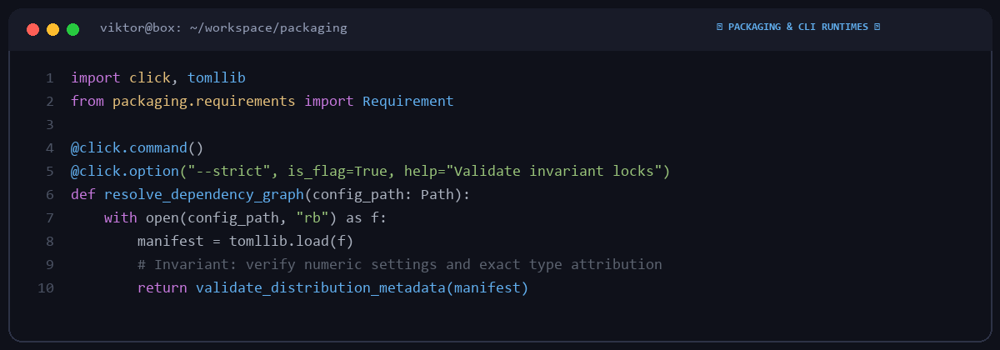

# Viktor Lind

  

Backend engineer based in Hamburg, Germany.  
Focusing on Python CLI runtimes, packaging architecture, and deterministic dependency resolution.

---

### 🏛️ Open Source Work & Contributions

A ledger of upstream open-source bug fixes and packaging patches:

| Project | Domain | Focus Area | Status |
|---|---|---|---|
| **[python-poetry/poetry](https://github.com/python-poetry/poetry)** | Packaging & CLI | Config key attribution & numeric validation | Active |
| **[pallets/click](https://github.com/pallets/click)** | CLI Parser | Parameter parsing & option flag evaluation | Contributor |
| **[psf/requests](https://github.com/psf/requests)** | HTTP Client | Connection pool lifecycle & adapter resilience | Contributor |

---

### 🛠️ Toolchain & Practices

- **Strict Test Coverage**: Local execution of unit and integration suites prior to review.
- **Minimal Diffs**: Focused, surgical patches that simplify code review and reduce regressions.
- **Code Hygiene**: Automated linting and formatting via Ruff and pre-commit hooks.

---
*Python • Packaging • CLI Internals • Linux*